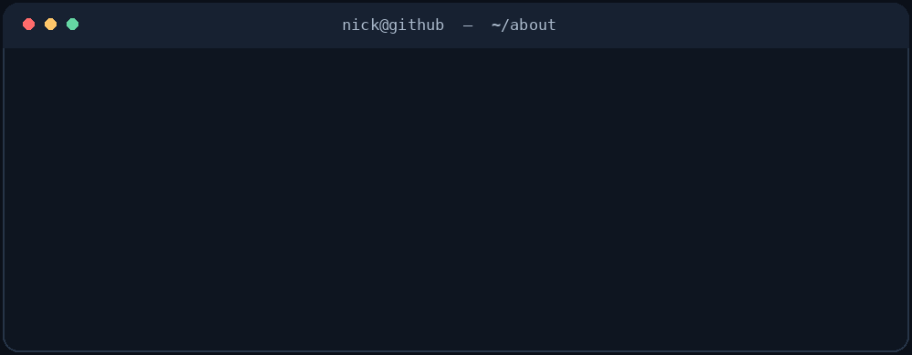

<!-- Profile README for github.com/sixteenbaw -->

# Nick

**Web development · Python · Back-end fundamentals · APIs & automation**

Systems Analysis & Development student based in Brazil.

  

  

  &nbsp;&nbsp;&nbsp;&nbsp;
  &nbsp;&nbsp;&nbsp;&nbsp;
  

## About me

I'm a developer who enjoys the process of turning an idea into something that actually works — from figuring out the interface to understanding what happens behind it.

I'm currently studying **Systems Analysis and Development**, building web projects, and expanding my knowledge of **Python, JavaScript, APIs, back-end development, and automation**. I also have an interest in **IT infrastructure and technical support**, which helps me see software beyond the code editor.

What interests me most is connecting the dots: how interfaces, application logic, data, and the underlying systems come together to solve a real problem.

## What I work with

### Languages & fundamentals

  

- **HTML & CSS** — semantic markup, responsive layouts, component styling, and accessible page structure.
- **JavaScript** — DOM interactions, application logic, asynchronous requests, and client-side functionality.
- **Python** — logic, functions, collections, scripts, and problem-solving.

### Back-end, APIs & data

  

- **Node.js** — server-side JavaScript, routing, and CRUD-style applications.
- **APIs** — HTTP requests, JSON, REST concepts, and connecting services.
- **Databases** — introductory SQL, data organization, and persistence fundamentals.
- **Automation** — scripts and workflows that cut down repetitive work.
- **Git & GitHub** — version control, repositories, and project organization.

### Frameworks & tools I'm familiar with

  

I've worked with **React** and **Vite** on web interfaces, explored **Next.js** and its application structure, and have introductory familiarity with **TypeScript**. I'm continuing to build depth in these tools rather than treating every technology I've tried as a specialty.

### Beyond the stack

`Responsive UI` · `Programming logic` · `CRUD` · `HTTP / JSON` · `API integration` · `Debugging` · `Troubleshooting` · `Process improvement` · `IT support`

## Lately

I'm focused on writing better code, understanding how applications communicate through APIs, and learning how development connects with infrastructure and real-world business needs.

Outside of tech, there's usually music playing. I'm also into Formula 1, football, and games.

---

  

Beyond the Code.

  

&nbsp;&nbsp;&nbsp;&nbsp;

