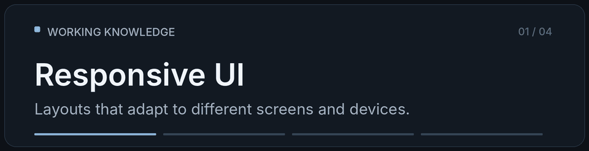

<!-- Profile README for github.com/sixteenbaw -->

# Nick

**Web development · Python · Back-end fundamentals · APIs & automation**

Systems Analysis & Development student · Born and raised in Brazil

 

 Based in São Paulo, Brazil

  

  

  &nbsp;&nbsp;&nbsp;&nbsp;
  &nbsp;&nbsp;&nbsp;&nbsp;
  

## The Story So Far

What's up? I’m Nick, a developer from São Paulo, Brazil, who enjoys <ins>turning ideas into things that actually work</ins>.

My journey into tech started with a **two-year technical program in IT**, where I was introduced to programming, software development, and the fundamentals of how systems work. What began as curiosity gradually turned into something I genuinely wanted to pursue.

Today, I'm studying **Systems Analysis and Development**, exploring different areas of software development, and building my skills through hands-on projects. I've worked with **web technologies, Python, JavaScript, Node.js, and APIs**, while experimenting with frameworks and tools that help bring more complex ideas to life.

My interests aren't limited to writing code. I'm also moving into **IT infrastructure and technical support**, which is helping me look at software beyond the code editor.

What I enjoy most is <ins>understanding how everything connects</ins> — from the interface someone uses to the **logic, data, and infrastructure** working behind the scenes.

I'm still figuring out where I want to specialize, and that's part of what makes the journey interesting. There's always something new to learn, something to improve, or something worth building.

## What I Work With

<h3 align="center">Languages & Fundamentals</h3>

  

- **HTML & CSS** — structuring semantic, accessible pages and creating responsive layouts that feel good to use.
- **JavaScript** — building interactive experiences, handling asynchronous requests, and working with data in the browser.
- **Python** — writing scripts, practicing programming logic, and solving problems with functions and data structures.

<h3 align="center">Back-end, APIs & Data</h3>

  

- **Node.js** — exploring server-side JavaScript, application routes, and CRUD-style features.
- **APIs & integration** — working with HTTP requests, JSON, REST concepts, and communication between services.
- **Databases** — learning relational modeling, SQL fundamentals, and how applications store and retrieve data.
- **Automation** — finding ways to connect tools and simplify repetitive workflows.

<h3 align="center">Frameworks & Libraries</h3>

  

- **React & Vite** — experience building web interfaces and organizing reusable components.
- **Next.js** — familiarity with its application structure and web development workflow.
- **TypeScript** — introductory knowledge; still developing confidence with typed JavaScript.

<h3 align="center">Development Tools</h3>

  

- **Git & GitHub** — version control, commits, repository management, and project documentation.
- **VS Code & Postman** — day-to-day development and exploring or testing API requests.

## Under the Hood

  

## Lately

- Studying **Systems Analysis and Development**.
- Moving into **IT infrastructure and support**.
- Strengthening my foundations in **back-end development, APIs, and automation**.
- Looking for ways to apply what I learn to real-world problems.

Outside of tech, there's usually music playing — mostly . I'm also into , football, movies, and games.

---

  

Beyond the Code.

  

  &nbsp;&nbsp;&nbsp;&nbsp;
  &nbsp;&nbsp;&nbsp;&nbsp;
  

